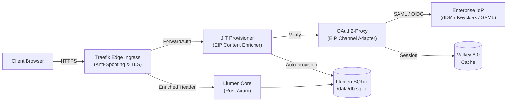

# 🌸 Llumen Enterprise Container Stack

[](LICENSE)
[](https://bun.sh)
[](docs/EIP_PATTERNS.md)
[](docs/SSO_INTEGRATION_GUIDE.md)

Production-grade, zero-trust container stack for hosting [**Llumen**](https://github.com/pinkfuwa/llumen) with enterprise Single Sign-On (OIDC / SAML 2.0), automated Just-In-Time (JIT) user provisioning, distributed session caching, and edge anti-spoofing security.

---

## 🎯 Mengapa Stack Ini Dibuat? (The Enterprise Gap)

[Llumen](https://github.com/pinkfuwa/llumen) adalah antarmuka web LLM berbasis Rust yang sangat cepat (<128MB RAM, binary statis ~17MB). Namun, untuk adopsi skala enterprise (seperti di BPS atau korporasi), terdapat beberapa kesenjangan mendasar:
1. **Ketiadaan IdP Connector**: Llumen hanya mendukung pembacaan header HTTP mentah (`TRUSTED_HEADER`).
2. **Kendala Database Lookup**: Jika username SSO belum ada di `db.sqlite`, Llumen menolak login dengan error `404 User not found`.
3. **Risiko Keamanan Spoofing Header**: Header auth yang diekspos langsung tanpa gateway rentan terhadap pemalsuan identitas (*header injection attacks*).

**Solusi Stack Ini**:
Mengimplementasikan **Enterprise Integration Patterns (EIP)** dan prinsip **SOLID** untuk membungkus Llumen dalam arsitektur *Zero-Trust*, menjembatani SSO OIDC/SAML 2.0 via **OAuth2-Proxy**, dan menyediakan adapter **JIT Provisioner** otomatis berlatensi sub-milidetik.

---

## 🏛️ Arsitektur & Pola EIP



| Pola EIP | Komponen | Peran Arsitektural |
| :--- | :--- | :--- |
| **Pipes and Filters** | Traefik -> JIT -> Llumen | Pemrosesan request bertahap: TLS -> Sanitasi -> Auth -> Enrich -> App |
| **Channel Adapter** | `auth-gateway` (OAuth2-Proxy) | Mengonversi protokol OIDC/SAML ke dalam token & header HTTP terenkripsi |
| **Message Translator**| `jit-provisioner` (Mediator) | Memetakan klaim identitas (`nip` / `email`) ke dalam `X-Forwarded-User` |
| **Content Enricher** | `jit-provisioner` (SQLite Sync) | Menjamin akun pengguna terdaftar otomatis di database sebelum request masuk |
| **Gatekeeper** | Traefik & Docker Internal Net | Menghapus header spoofing dari luar; port aplikasi terisolasi total |

---

## 🚀 Panduan Memulai Cepat (Quickstart)

### 1. Inisialisasi Environment & Secrets
```bash
git clone https://github.com/ipds6104/llumen-enterprise-stack.git
cd llumen-enterprise-stack

# Otomatis membuat .env dan meng-generate secret kriptografis
make init
```

### 2. Konfigurasi Kredensial di `.env`
Buka berkas `.env` dan sesuaikan parameter berikut:
```bash
DOMAIN=llumen.dvlpid.my.id
OPENROUTER_API_KEY=sk-or-v1-your-key-here
OIDC_CLIENT_ID=llumen-enterprise-app
OIDC_CLIENT_SECRET=secret-dari-idp
```

### 3. Jalankan Container Stack
```bash
# Jalankan mode OIDC Enterprise (rIDM / Keycloak / Entra ID)
make up

# ATAU jalankan dengan SAML 2.0 Federation overlay
make saml

# Periksa status kesehatan seluruh kontainer
make health
```

---

## 📚 Dokumentasi Terperinci

- [📘 Panduan Integrasi SSO (rIDM, Keycloak, Azure AD, SAML)](docs/SSO_INTEGRATION_GUIDE.md)
- [🧩 Pemetaan Enterprise Integration Patterns (EIP)](docs/EIP_PATTERNS.md)
- [🏛️ Diagram Detail & Arsitektur Zero-Trust](docs/ARCHITECTURE.md)
- [🔒 Panduan Hardening Keamanan Enterprise](docs/SECURITY_HARDENING.md)

---

## 🛡️ Lisensi
Dilisensikan di bawah lisensi permisif [MIT](LICENSE). Bebas digunakan dan dimodifikasi untuk kebutuhan korporasi dan pemerintahan.
