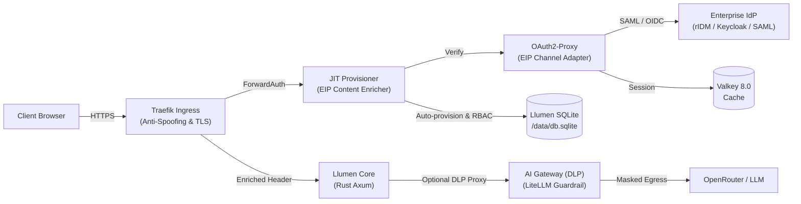

# 🌸 Llumen Enterprise Container Stack

[](LICENSE)
[](https://bun.sh)
[](docs/EIP_PATTERNS.md)
[](docs/SSO_INTEGRATION_GUIDE.md)
[](docs/CISO_SECURITY_WHITEPAPER.md)

Production-grade, zero-trust container stack for hosting [**Llumen**](https://github.com/pinkfuwa/llumen) with enterprise Single Sign-On (OIDC / SAML 2.0), automated Just-In-Time (JIT) user provisioning, distributed session caching, CISO guardrails, and Data Loss Prevention (DLP) egress controls.

---

## 🎯 Mengapa Stack Ini Dibuat? (The Enterprise Gap)

[Llumen](https://github.com/pinkfuwa/llumen) adalah antarmuka web LLM berbasis Rust yang sangat cepat (<128MB RAM, binary statis ~17MB). Namun, untuk adopsi skala enterprise (seperti di BPS atau korporasi), terdapat kesenjangan mendasar:
1. **Ketiadaan IdP Connector**: Llumen hanya mendukung pembacaan header HTTP mentah (`TRUSTED_HEADER`).
2. **Kendala Database Lookup**: Jika username SSO belum ada di `db.sqlite`, Llumen menolak login dengan error `404 User not found`.
3. **Risiko Keamanan Spoofing Header**: Header auth yang diekspos langsung tanpa gateway rentan terhadap pemalsuan identitas (*header injection*).
4. **Kebutuhan Kontrol CISO**: Kurangnya kontrol RBAC grup AD/satker, ketidakmampuan revokasi darurat (*killswitch*), dan risiko kebocoran data sensitif (*PII egress*) ke cloud LLM.

**Solusi Stack Ini**:
Mengimplementasikan **Enterprise Integration Patterns (EIP)** dan prinsip **SOLID** untuk membungkus Llumen dalam arsitektur *Zero-Trust*, menjembatani SSO OIDC/SAML 2.0 via **OAuth2-Proxy**, adapter **JIT Provisioner** otomatis berlatensi sub-milidetik, serta **AI Gateway & DLP Guardrail** untuk kepatuhan CISO.

---

## 🏛️ Arsitektur & Pola EIP



| Pola EIP | Komponen | Peran Arsitektural & Kontrol CISO |
| :--- | :--- | :--- |
| **Pipes and Filters** | Traefik -> JIT -> Llumen | Pemrosesan sekuensial: TLS -> Anti-Spoofing -> Rate-Limit -> RBAC -> App |
| **Channel Adapter** | `auth-gateway` (OAuth2-Proxy) | Mengonversi protokol OIDC/SAML ke dalam token & header HTTP terenkripsi |
| **Message Translator**| `jit-provisioner` (Mediator) | Memetakan klaim identitas (`nip` / `email`) ke dalam `X-Forwarded-User` |
| **Content Enricher** | `jit-provisioner` (SQLite Sync) | Menjamin akun pengguna terdaftar otomatis di database saat login pertama |
| **Gatekeeper & DLP** | AI Gateway (LiteLLM / Propylon) | Memblokir/masking kebocoran PII (NIK, NIP, API Key) dan membatasi model |

---

## 🛡️ CISO & SOC Operational Controls

Stack ini dilengkapi perkakas operasi darurat untuk tim SOC / Keamanan:
- **Revokasi Akses Instan & Blocklist**:
  ```bash
  ./scripts/revoke-session.sh block 199503112022031001 "Indikasi kebocoran kredensial"
  ./scripts/revoke-session.sh unblock 199503112022031001
  ./scripts/revoke-session.sh list
  ```
- **Emergency Killswitch Global**:
  ```bash
  ./scripts/revoke-session.sh killswitch on   # Menghentikan seluruh akses LLM (<10ms)
  ./scripts/revoke-session.sh killswitch off  # Memulihkan layanan normal
  ```
- **SCIM Offboarding / De-provisioning**:
  ```bash
  ./scripts/revoke-session.sh deactivate <username>
  ```
- **Audit Kepatuhan Keamanan**:
  ```bash
  make audit   # Memeriksa izin berkas, isolasi port, dan pengujian ketat
  ```

---

## 🚀 Panduan Memulai Cepat (Quickstart)

### 1. Inisialisasi Environment & Secrets
```bash
git clone https://github.com/ipds6104/llumen-enterprise-stack.git
cd llumen-enterprise-stack
make init
```

### 2. Jalankan Container Stack
```bash
# Mode Standard OIDC (rIDM Mempawah / Keycloak / Entra ID)
make up

# Mode Enterprise AI Gateway dengan DLP & PII Masking
make gateway

# Mode SAML 2.0 Federation overlay (Dex Broker)
make saml
```

---

## 📚 Dokumentasi Terperinci & Roadmap

- [🗺️ **Peta Jalan Strategis Enterprise (Roadmap 7 Fase)**](docs/roadmap/00_ROADMAP_OVERVIEW.md)
  - [Phase 1: Identity & Hierarchical RBAC](docs/roadmap/01_PHASE_1_IDENTITY_FEDERATION_AND_RBAC.md)
  - [Phase 2: High Availability & Litestream S3](docs/roadmap/02_PHASE_2_HIGH_AVAILABILITY_AND_REPLICATION.md)
  - [Phase 3: Advanced DLP & Prompt Guardrails](docs/roadmap/03_PHASE_3_ADVANCED_DLP_AND_PROMPT_GUARDRAILS.md)
  - [Phase 4: FinOps & Token Budgeting](docs/roadmap/04_PHASE_4_FINOPS_TOKEN_BUDGETING_AND_METRICS.md)
  - [Phase 5: Enterprise Document Knowledge RAG](docs/roadmap/05_PHASE_5_ENTERPRISE_RAG_AND_KNOWLEDGE_VAULT.md)
  - [Phase 6: Multi-Model Routing & Local vLLM Fallback](docs/roadmap/06_PHASE_6_MODEL_FAILOVER_AND_PRIVATE_VLLM.md)
  - [Phase 7: Centralized SIEM & Compliance Gauntlet](docs/roadmap/07_PHASE_7_SIEM_AUDIT_LOGGING_AND_COMPLIANCE.md)
- [🛡️ CISO Security Whitepaper & Compliance Matrix](docs/CISO_SECURITY_WHITEPAPER.md)
- [🔒 Data Loss Prevention (DLP) & AI Egress Control](docs/DLP_AND_EGRESS_CONTROL.md)
- [📘 Panduan Integrasi SSO (rIDM, Keycloak, Azure AD, SAML)](docs/SSO_INTEGRATION_GUIDE.md)
- [🧩 Pemetaan Enterprise Integration Patterns (EIP)](docs/EIP_PATTERNS.md)
- [🏛️ Diagram Detail & Arsitektur Zero-Trust](docs/ARCHITECTURE.md)
- [🔒 Panduan Hardening Keamanan Enterprise](docs/SECURITY_HARDENING.md)

---

## 🛡️ Lisensi
Dilisensikan di bawah lisensi permisif [MIT](LICENSE). Bebas digunakan dan dimodifikasi untuk kebutuhan korporasi dan pemerintahan.
