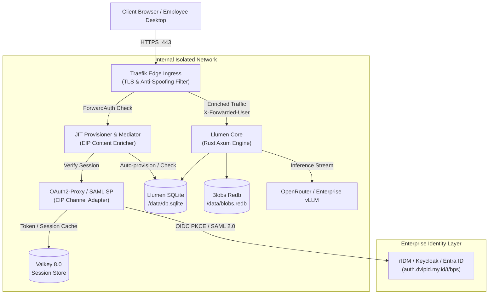
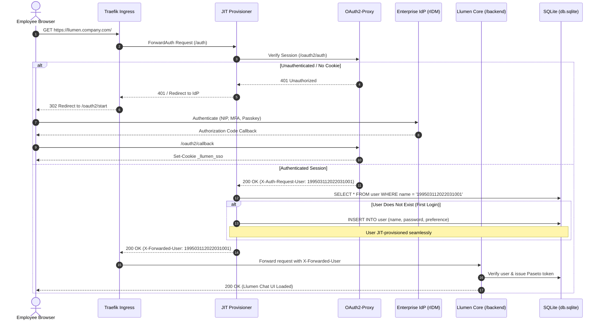

# 🏛️ Architecture: Llumen Enterprise Container Stack

This document details the high-assurance, enterprise-grade architecture for self-hosting **Llumen** ([pinkfuwa/llumen](https://github.com/pinkfuwa/llumen)) with SSO (OIDC/SAML 2.0), JIT Provisioning, and Zero-Trust Edge Security.

---

## 📐 High-Level Component Topology

---

## 🔄 Authentication & JIT Provisioning Sequence

---

## 💎 SOLID Principles Application

1. **Single Responsibility Principle (SRP)**:
   - `Traefik`: Only handles edge routing, TLS certificates, and rate limiting.
   - `OAuth2-Proxy`: Only terminates SSO tokens, cookies, and IdP handshakes.
   - `JIT Provisioner`: Only bridges user identities and provisions database records.
   - `Llumen Core`: Only handles chat completion streaming and prompt management.
2. **Open/Closed Principle (OCP)**:
   - Pluggable auth profiles (`docker-compose.saml.yml`, `docker-compose.dev.yml`) extend functionality without altering core services.
3. **Liskov Substitution Principle (LSP)**:
   - Traefik ForwardAuth and OAuth2-Proxy satisfy standard HTTP specifications and can be substituted with any compliant enterprise gateway.
4. **Interface Segregation Principle (ISP)**:
   - Administrative hooks (`/api/users`) and metric endpoints are segregated from public end-user ingress paths.
5. **Dependency Inversion Principle (DIP)**:
   - All modules depend on environment abstractions (`.env.example`) rather than concrete container hostnames or local credentials.
