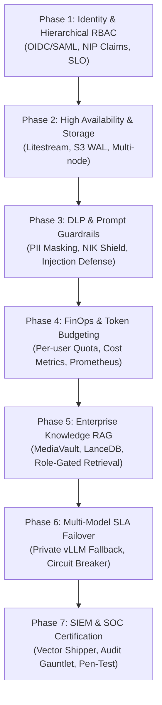

# 🗺️ Master Roadmap: Enterprise-Ready Llumen Stack

Dokumen ini adalah peta jalan strategis multi-fase untuk membawa [pinkfuwa/llumen](https://github.com/pinkfuwa/llumen) ke tingkat kematangan operasional penuh bagi instansi pemerintah (seperti BPS) dan korporasi berskala enterprise.

---

## 🎯 Visi & Sasaran Strategis

Mengubah antarmuka LLM mandiri yang cepat menjadi platform percakapan kecerdasan artifisial perusahaan yang:
1. **Sepenuhnya Terfederasi (Zero-Trust Identity)**: Autentikasi SSO OIDC/SAML, otorisasi RBAC berjenjang, dan sinkronisasi NIP otomatis.
2. **Berdaya Tahan Tinggi (High Availability & Zero Data Loss)**: Replikasi basis data terdistribusi dan pemulihan bencana instan.
3. **Aman & Patuh Regulasi (CISO & DLP Ready)**: Pencegahan kebocoran data sensitif (NIK, NIP, rahasia negara) dan kepatuhan UU PDP No. 27/2022.
4. **Terkendali Secara Finansial (FinOps & Token Budgeting)**: Kuota token departemental dan pemantauan biaya real-time.
5. **Kaya Pengetahuan Institusional (Enterprise RAG)**: Akses cerdas ke basis data dokumen organisasi dengan hak akses berbasis peran.

---

## 📊 Matriks Fase Pengembangan

| Fase | Dokumen Roadmap | Fokus Utama | Luaran Kunci |
| :---: | :--- | :--- | :--- |
| **01** | [Phase 1: Identity & RBAC](01_PHASE_1_IDENTITY_FEDERATION_AND_RBAC.md) | Otorisasi berjenjang & NIP | Hierarchical RBAC, Satker Scoping, Back-channel SLO |
| **02** | [Phase 2: HA & Storage](02_PHASE_2_HIGH_AVAILABILITY_AND_REPLICATION.md) | Keandalan data & replikasi | Litestream S3 replication, Zero-downtime rolling update |
| **03** | [Phase 3: DLP Guardrails](03_PHASE_3_ADVANCED_DLP_AND_PROMPT_GUARDRAILS.md) | Pencegahan kebocoran data | NIK/NIP Regex Masking, NeMo/Llama Guard scanning |
| **04** | [Phase 4: FinOps & Budget](04_PHASE_4_FINOPS_TOKEN_BUDGETING_AND_METRICS.md) | Pengendalian biaya token | User token quota, Grafana dashboards, Slack alert |
| **05** | [Phase 5: Enterprise RAG](05_PHASE_5_ENTERPRISE_RAG_AND_KNOWLEDGE_VAULT.md) | Pengetahuan dokumen rahasia | Role-gated semantic search, LanceDB/MediaVault bridge |
| **06** | [Phase 6: Failover & vLLM](06_PHASE_6_MODEL_FAILOVER_AND_PRIVATE_VLLM.md) | Ketersediaan saat offline | Auto-fallback on-prem vLLM/Ollama, Circuit breaker |
| **07** | [Phase 7: SIEM & Audit](07_PHASE_7_SIEM_AUDIT_LOGGING_AND_COMPLIANCE.md) | Kepatuhan hukum & audit | Vector/FluentBit forwarder, SOC 2 / ISO 27001 gauntlet |

---

## 🛡️ Tata Kelola Rekayasa (Old-Coder Compliance)

Seluruh implementasi fase wajib mematuhi aturan berikut:
1. **Interface-First Design**: Kontrak interface didefinisikan sebelum implementasi kode.
2. **Batas Baris Deterministik**: Setiap berkas wajib berukuran `< 350 lines` (`bash scripts/check-line-limits.sh`).
3. **Prinsip Zero-Mock**: Jalur produksi tidak boleh mengandung data palsu atau mock stubs.
4. **Siklus Bukti Empiris**: Setiap fase ditutup dengan *Evidence Report* dan verifikasi gauntlet hijau.
