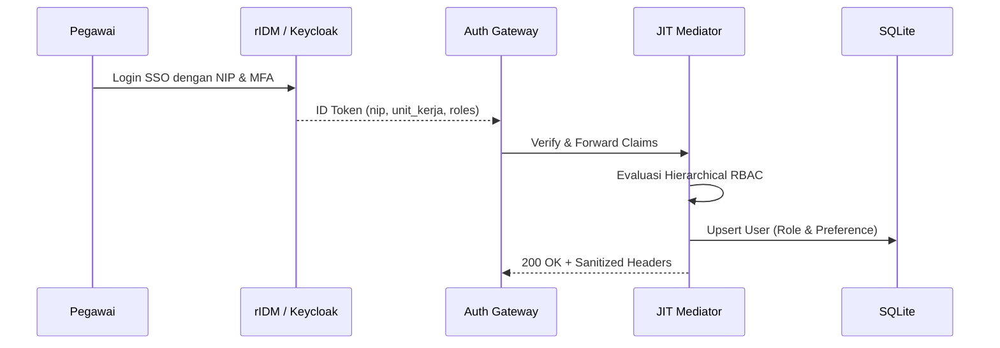

# 🏛️ Phase 1: Identity Federation & Hierarchical RBAC

Fase ini mematangkan federasi identitas enterprise ke tingkat *fine-grained authorization* (AuthZ) dengan pemetaan atribut pegawai institusional (NIP 18 digit, unit kerja, jabatan).

---

## 🎯 Sasaran Utama

1. **Hierarchical RBAC (Peran Berjenjang)**:
   - `super_admin`: Kendali penuh sistem, audit log, konfigurasi model, dan killswitch.
   - `satker_admin`: Pengelola unit kerja lokal (misal: admin Satker 6104 Mempawah).
   - `operator`: Pengguna dengan akses model lanjutan & kuota token lebih tinggi.
   - `pegawai`: Akses standar chat harian ke model korporat.
   - `guest`: Akses terbatas read-only atau demo.
2. **Klaim Institusional Berkelanjutan**:
   - Memetakan klaim rIDM: `nip`, `nip9`, `unit_kerja`, `jabatan`, `golongan`, `pangkat`.
   - Menginjeksikan metadata ke session context Llumen via header atau user preference.
3. **Single Logout (SLO) Back-Channel & Front-Channel**:
   - Saat pegawai logout di portal pusat (`auth.dvlpid.my.id`), sesi Llumen otomatis terputus seketika tanpa jeda.

---

## 📐 Arsitektur & Kontrak Interface



### Kontrak Interface (`IHierarchicalRbacEngine`)
```typescript
export interface UserRoleClaim {
  nip: string;
  unitKerja: string;
  roles: string[];
  jabatan?: string;
}

export interface IHierarchicalRbacEngine {
  resolveEffectiveRole(claims: UserRoleClaim): "super_admin" | "satker_admin" | "operator" | "pegawai" | "guest";
  isPermitted(role: string, action: string, resource: string): boolean;
  filterModelClearance(role: string, requestedModel: string): boolean;
}
```

---

## 📦 Rencana Luaran & Komponen

1. `services/jit-provisioner/src/services/rbac-engine.ts`: Mesin resolusi peran berjenjang.
2. `services/auth-gateway/slo-handler`: Penanganan endpoint logout back-channel OIDC.
3. `tests/rbac-engine.test.ts`: Pengujian berbasis properti untuk resolusi peran dan hak akses model.

---

## 🧪 Kriteria Keberhasilan & Gauntlet

- [ ] Semua peran berhasil dipetakan dari token rIDM tanpa ada peran tak dikenal yang mendapat eskalasi hak istimewa.
- [ ] Pegawai non-admin yang mencoba memanggil model penalaran berat (*expensive reasoning model*) ditolak dengan pesan kebijakan ramah.
- [ ] Logout di IdP memutus cookie `_llumen_sso` dalam <500ms.
- [ ] 100% berkas berukuran `< 350 lines` dan lulus verifikasi `make test`.
