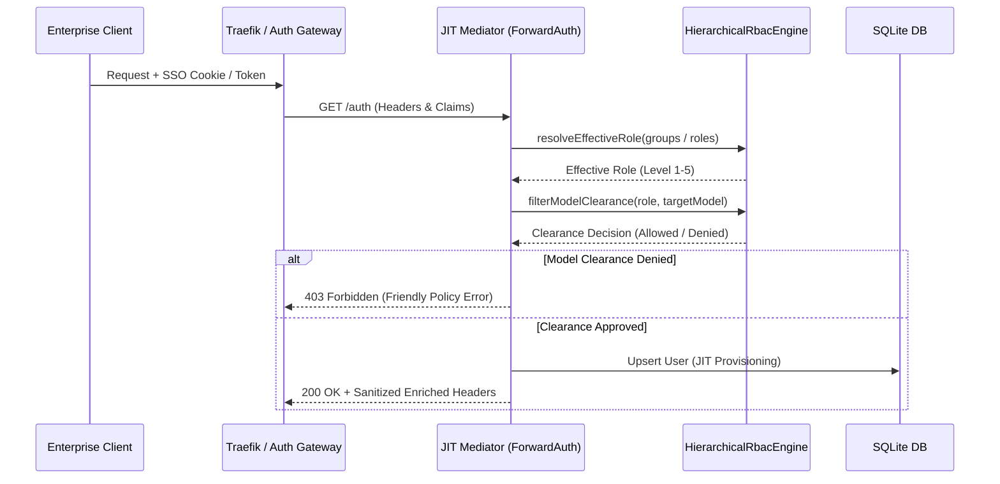

# 🏛️ Phase 1: Identity Federation & Universal Hierarchical RBAC

Fase ini mematangkan federasi identitas enterprise ke tingkat *fine-grained authorization* (AuthZ) dengan hirarki peran universal (*Universal Hierarchical RBAC*), pemetaan alias kanonikal (*Canonical Alias Normalization*), serta penegakan batas akses model AI (*Model Clearance Tiers*).

---

## 🎯 Sasaran Utama & Struktur Peran Universal

1. **Universal Hierarchical RBAC (5 Tingkat Berjenjang Monotonik)**:
   - `super_admin` (Level 5): Kendali platform global, CISO controls, audit SIEM, killswitch, dan akses tak terbatas ke seluruh model AI.
   - `tenant_admin` (Level 4): Administrator departemen, divisi, satker, atau unit organisasi; pengawasan pengguna dan kuota tenant.
   - `power_user` (Level 3): Pengguna dengan privilege khusus, insinyur/developer, analis data, operator; akses ke model penalaran (*frontier reasoning models*) & kuota token tinggi.
   - `member` (Level 2): Pengguna standar enterprise, staf internal, karyawan harian; akses penuh ke model korporat standar.
   - `guest` (Level 1): Pengguna eksternal, kontraktor sementara, auditor, atau akun tamu; dibatasi hanya pada model ringkas/hemat (*tier_basic*).

2. **Pemetaan Alias Kanonikal (Backward Compatibility & Institutional Federation)**:
   - `super_admin` ← `admin`, `ciso`, `root`, `security_officer`, `system_admin`, `administrator`.
   - `tenant_admin` ← `dept_admin`, `division_head`, `satker_admin`, `kepala_satker`, `manager`, `org_admin`.
   - `power_user` ← `operator`, `lead`, `developer`, `engineer`, `analyst`, `specialist`, `ppk`, `ppspm`.
   - `member` ← `pegawai`, `staff`, `employee`, `user`, `internal`, `asn`.
   - `guest` ← `viewer`, `external`, `contractor`, `auditor`, `intern`, `tamu`.

3. **Tingkatan Klirens Model AI (Model Clearance Tiers)**:
   - `tier_basic` (Level 1+ / `guest`): `gpt-4o-mini`, `gemini-1.5-flash`, `kimi-k3`.
   - `tier_standard` (Level 2+ / `member`): `gpt-4o`, `gemini-1.5-pro`, `claude-3-5-haiku`.
   - `tier_advanced` (Level 3+ / `power_user`): `claude-3-5-sonnet`, `deepseek-coder`, `qwen-2.5-coder`.
   - `tier_reasoning` (Level 3+ / `power_user`): `deepseek-r1`, `o1`, `o1-mini`, `o3-mini`.

---

## 📐 Arsitektur & Kontrak Interface



### Kontrak Interface (`IHierarchicalRbacEngine`)
```typescript
export type EnterpriseRole =
  | "super_admin"
  | "tenant_admin"
  | "power_user"
  | "member"
  | "guest";

export type ModelTier =
  | "tier_basic"
  | "tier_standard"
  | "tier_advanced"
  | "tier_reasoning";

export interface IHierarchicalRbacEngine {
  resolveEffectiveRole(claims: UserRoleClaim | string[]): EnterpriseRole;
  getRoleLevel(role: EnterpriseRole): number;
  isAtLeast(userRole: EnterpriseRole, requiredRole: EnterpriseRole): boolean;
  isPermitted(role: EnterpriseRole, action: string, resource?: string): boolean;
  getModelTier(modelName: string): ModelTier;
  filterModelClearance(role: EnterpriseRole, requestedModel: string): boolean;
  listAllowedModelTiers(role: EnterpriseRole): ModelTier[];
}
```

---

## 📦 Komponen & Implementasi Terverifikasi

1. [x] `services/jit-provisioner/src/services/rbac-engine.ts`: Mesin RBAC berjenjang universal dengan resolusi peran tertinggi (*highest precedence resolution*).
2. [x] `services/jit-provisioner/src/services/forward-auth.ts`: Integrasi klirens model AI dan injeksi header `X-Forwarded-Role`, `X-Forwarded-Tier`, `X-User-Role-Level`.
3. [x] `services/jit-provisioner/src/index.ts`: Endpoint inspeksi RBAC publik `/api/admin/roles`.
4. [x] `services/jit-provisioner/tests/rbac-engine.test.ts`: Gauntlet pengujian 15 skenario hierarki, alias institusional, dan klirens model.
5. [x] `services/jit-provisioner/tests/forward-auth.test.ts`: Pengujian integrasi penolakan model tanpa klirens (403) dan pengayaan header otorisasi.

---

## 🧪 Kriteria Keberhasilan & Gauntlet

- [x] Semua peran berhasil dipetakan dari token SSO/SAML tanpa ada peran tak dikenal yang mendapat eskalasi hak istimewa.
- [x] Pengguna `member` atau `guest` yang mencoba memanggil model penalaran (*deepseek-r1*, *o1*) ditolak secara ramah dengan status 403 Forbidden.
- [x] Pengguna dengan peran ganda (*multi-role*) secara deterministik diangkat ke peran tertinggi dalam hierarki.
- [x] Injeksi header RBAC downstream (`X-Forwarded-Role`, `X-Forwarded-Tier`, `X-User-Role-Level`) terverifikasi pada respon 200 OK.
- [x] 100% berkas berukuran `< 350 lines` dan seluruh pengujian (29 tests) lulus pada `bun test`.
