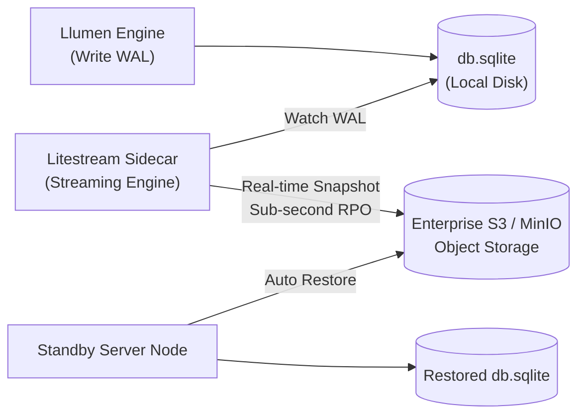

# 🔄 Phase 2: High Availability & Disaster Recovery

Fase ini meniadakan titik kegagalan tunggal (*Single Point of Failure / SPOF*) pada penyimpanan lokal dan menjamin ketersediaan tinggi (*High Availability*) 99.9% uptime.

---

## 🎯 Sasaran Utama

1. **Replikasi Basis Data Berkelanjutan (Continuous WAL Replication)**:
   - Mengintegrasikan **Litestream** untuk streaming berkas WAL SQLite secara real-time ke penyimpanan objek S3 / MinIO / Ceph dengan RPO (*Recovery Point Objective*) < 1 detik.
   - Restorasi otomatis basis data saat kontainer baru dinyalakan di server lain.
2. **Ketersediaan Tinggi Gateway Sesi (Valkey Sentinel / Cluster)**:
   - Menghubungkan OAuth2-Proxy ke klaster Valkey multi-node agar sesi pegawai tidak terputus saat satu node server mengalami gangguan.
3. **Pembaruan Tanpa Henti (Zero-Downtime Rolling Deployment)**:
   - Prosedur deployment *blue-green* atau *rolling restart* tanpa memutuskan streaming percakapan SSE aktif.

---

## 📐 Arsitektur Replikasi Litestream & S3



### Konfigurasi Replikasi (`services/storage/litestream.yml`)
```yaml
dbs:
  - path: /data/db.sqlite
    replicas:
      - type: s3
        bucket: enterprise-llumen-backups
        path: db
        endpoint: s3.dvlpid.my.id
        sync-interval: 1s
```

---

## 📦 Rencana Luaran & Komponen

1. `docker-compose.ha.yml`: Overlay compose untuk klaster HA (Litestream sidecar + Valkey cluster).
2. `scripts/disaster-recovery.sh`: Skrip otomasi uji pemulihan bencana (*DR drill*).
3. `services/storage/litestream.yml`: Definisi sinkronisasi objek S3 terenkripsi.

---

## 🧪 Kriteria Keberhasilan & Gauntlet

- [ ] Saat kontainer basis data dihapus paksa (`rm -rf /data/db.sqlite`), Litestream berhasil memulihkan 100% data riwayat chat dari S3 dalam <3 detik.
- [ ] Simulasi node restart tidak menyebabkan *session drop* (pegawai tidak perlu login ulang).
- [ ] 100% berkas berukuran `< 350 lines` dan lulus uji `scripts/check-line-limits.sh`.
