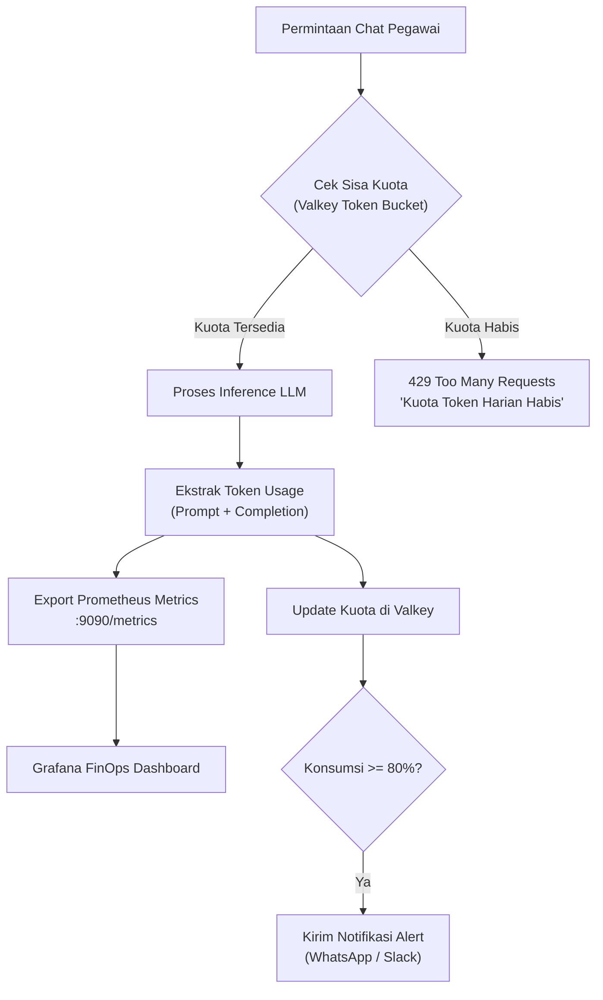

# 💰 Phase 4: FinOps, Token Budgeting & Telemetry

Fase ini menyediakan visibilitas dan kendali finansial penuh (*FinOps*) atas penggunaan LLM untuk mencegah pembengkakan biaya dan menegakkan kuota per departemen atau satker.

---

## 🎯 Sasaran Utama

1. **Alokasi Kuota Token Bertingkat (Hierarchical Token Quotas)**:
   - Kuota bulanan per Satker (misal: Satker 6104 mendapat alokasi 50 juta token/bulan).
   - Batas harian per Pegawai (misal: 100.000 token/hari) untuk mencegah penyalahgunaan skrip otomatis tak terkontrol.
2. **Telemetri Prometheus & Metrik Real-Time**:
   - `llumen_tokens_prompt_total{user, satker, model}`
   - `llumen_tokens_completion_total{user, satker, model}`
   - `llumen_estimated_cost_usd_total{satker, model}`
3. **Dasbor Eksekutif Grafana & Notifikasi Anggaran**:
   - Dasbor visual real-time untuk pimpinan satker melihat tren konsumsi token.
   - Webhook otomatis (WhatsApp via whatsmeow / Slack / Email) saat satker mencapai 80% dan 100% kuota.

---

## 📐 Arsitektur FinOps & Metering



### Kontrak Interface (`IFinOpsQuotaEngine`)
```typescript
export interface TokenUsageReport {
  promptTokens: number;
  completionTokens: number;
  totalTokens: number;
  estimatedCostUsd: number;
}

export interface IFinOpsQuotaEngine {
  checkQuota(userId: string, satkerId: string): Promise<{ allowed: boolean; remainingDailyTokens: number }>;
  recordUsage(userId: string, satkerId: string, model: string, usage: TokenUsageReport): Promise<void>;
  getSatkerUsage(satkerId: string, month: string): Promise<{ allocated: number; consumed: number }>;
}
```

---

## 📦 Rencana Luaran & Komponen

1. `services/gateway/finops/quota-engine.ts`: Mesin pengecekan dan pengurangan kuota berbasis Valkey.
2. `services/gateway/finops/metrics-exporter.ts`: Kolektor metrik Prometheus standar enterprise.
3. `dashboards/grafana-llumen-finops.json`: Template dasbor Grafana siap impor.

---

## 🧪 Kriteria Keberhasilan & Gauntlet

- [ ] Pengguna yang kuota tokennya habis seketika diblokir dari permintaan baru dengan pesan informatif.
- [ ] Metrik konsumsi token tercatat akurat dengan deviasi <1% terhadap faktur penyedia LLM.
- [ ] Pengecekan kuota di memori Valkey berlangsung dalam <5ms per request.
- [ ] 100% berkas berukuran `< 350 lines` dan lulus uji `scripts/check-line-limits.sh`.
