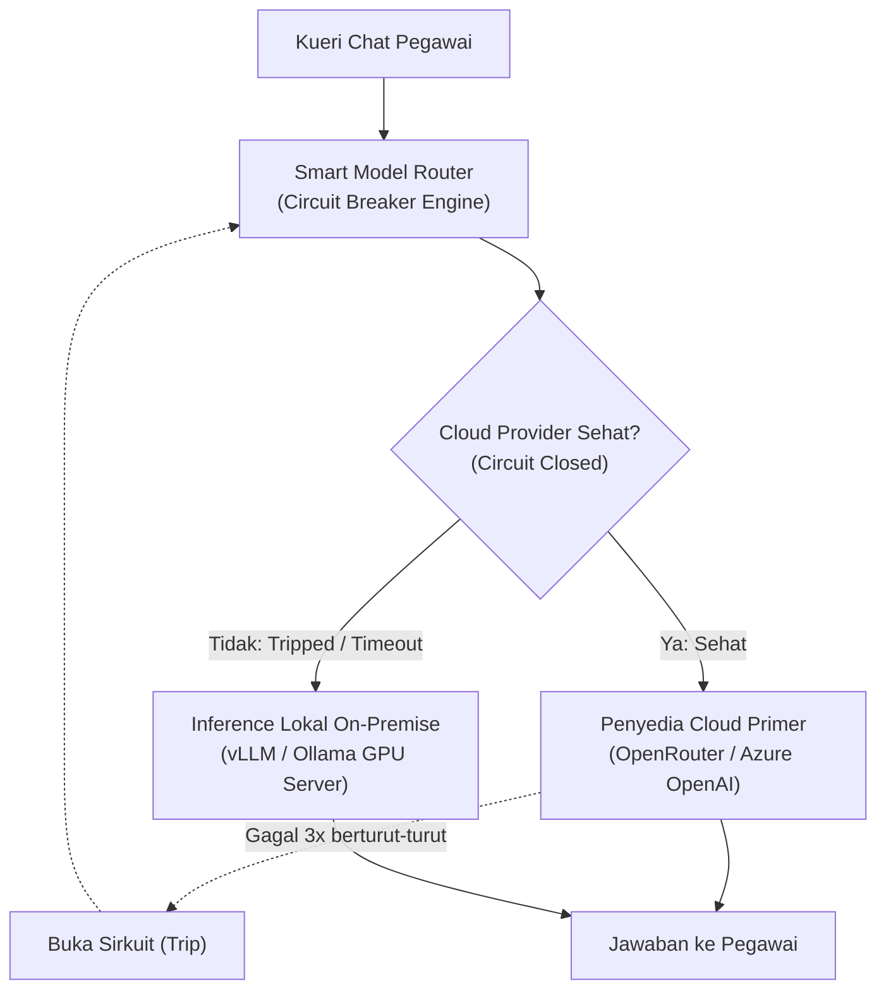

# 🔀 Phase 6: Multi-Model Routing & Local vLLM Fallback

Fase ini menjamin ketahanan operasional (*business continuity*) ketika koneksi internet luar atau penyedia cloud LLM mengalami gangguan, dengan otomatis beralih (*failover*) ke inference lokal di server kantor (*on-premise vLLM / Ollama*).

---

## 🎯 Sasaran Utama

1. **Otomatis Beralih ke Model Lokal (Offline / Disaster Fallback)**:
   - Jika OpenRouter / Azure OpenAI mengalami timeout atau error 5xx berturut-turut, sistem otomatis mengalihkan kueri ke instance vLLM lokal (misal: Qwen 2.5 14B / 32B atau Llama 3) yang berjalan di server GPU kantor.
2. **Penerapan Pola Circuit Breaker (EIP Circuit Breaker)**:
   - Memantau tingkat kegagalan (*error rate*). Jika 3 kueri berturut-turut gagal, sirkuit membuka (*tripped*) dan langsung mengarahkan request ke model cadangan tanpa menunggu timeout panjang.
3. **Smart Routing Dinamis (Cost & Latency Optimizer)**:
   - Kueri umum diarahkan ke model cepat dan hemat biaya.
   - Kueri penalaran kompleks diarahkan ke model penalaran khusus sesuai izin peran pengguna.

---

## 📐 Arsitektur Failover Cerdas



### Kontrak Interface (`IModelFailoverRouter`)
```typescript
export interface ModelRouteTarget {
  id: string;
  endpoint: string;
  apiKey: string;
  isLocal: boolean;
  maxTokens: number;
}

export interface IModelFailoverRouter {
  selectHealthyTarget(modelName: string): Promise<ModelRouteTarget>;
  recordFailure(targetId: string, error: Error): void;
  recordSuccess(targetId: string): void;
  getCircuitState(): Record<string, "CLOSED" | "HALF_OPEN" | "OPEN">;
}
```

---

## 📦 Rencana Luaran & Komponen

1. `services/gateway/router/failover-engine.ts`: Mesin circuit breaker dan health prober upstream.
2. `docker-compose.local-vllm.yml`: Profil compose untuk menyambungkan server GPU lokal on-premise.
3. `tests/model-failover.test.ts`: Uji simulasi matinya jaringan cloud dan pembuktian failover <200ms.

---

## 🧪 Kriteria Keberhasilan & Gauntlet

- [ ] Saat koneksi internet publik diputus secara sengaja, pegawai tetap dapat melakukan percakapan via LLM lokal tanpa pesan error crash.
- [ ] Sirkuit otomatis pulih (*half-open* -> *closed*) ketika penyedia cloud kembali normal.
- [ ] 100% berkas berukuran `< 350 lines` dan lolos pengujian `scripts/check-line-limits.sh`.
