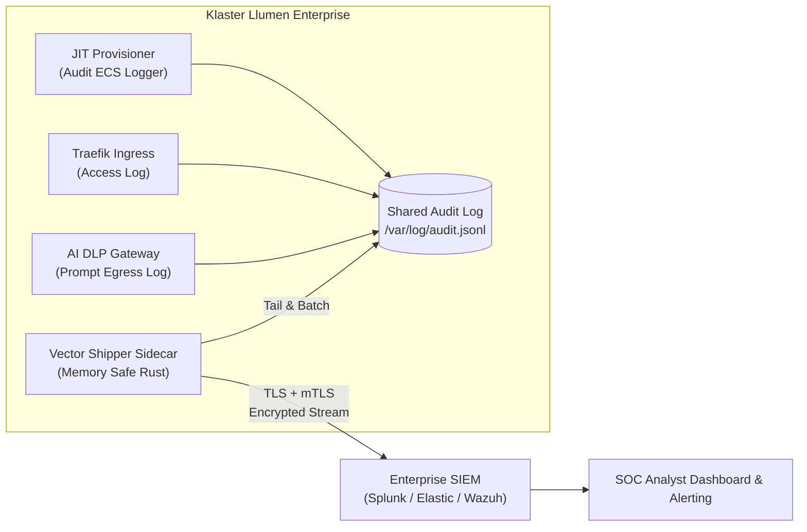

# 🔍 Phase 7: Centralized SIEM & Compliance Gauntlet

Fase ini memfinalisasi kepatuhan audit formal perusahaan dengan pengiriman log otomatis ke SIEM terpusat dan gauntlet pengujian kepatuhan keamanan otomatis.

---

## 🎯 Sasaran Utama

1. **Pengiriman Log Otomatis ke SIEM Perusahaan (Vector / FluentBit Sidecar)**:
   - Mengalirkan seluruh log audit (format ECS) secara real-time ke Splunk, Elasticsearch, Wazuh, atau Syslog pusat dengan buffering andal saat jaringan terputus.
2. **Integritas Bukti Forensik (Tamper-Evident Audit Records)**:
   - Menandatangani (*HMAC sign*) setiap log audit untuk memastikan log tidak dapat dimanipulasi atau dihapus pasca-insiden.
3. **Gauntlet Pengujian Kepatuhan Otomatis (Compliance Gauntlet Suite)**:
   - Skrip pengujian otomatis yang memvalidasi kontrol **SOC 2 Type II**, **ISO/IEC 27001:2022**, dan **UU PDP No. 27/2022** dalam satu perintah terminal.

---

## 📐 Arsitektur SIEM Log Forwarding



### Konfigurasi Pengiriman Log (`services/logging/vector.toml`)
```toml
[sources.audit_files]
type = "file"
include = ["/var/log/audit/*.jsonl"]
read_from = "beginning"

[transforms.parse_ecs]
type = "remap"
inputs = ["audit_files"]
source = '''
. = parse_json!(.message)
.host.name = get_hostname!()
'''

[sinks.siem_elastic]
type = "elasticsearch"
inputs = ["parse_ecs"]
endpoint = "${SIEM_ENDPOINT}"
auth.strategy = "bearer"
auth.token = "${SIEM_API_TOKEN}"
```

---

## 📦 Rencana Luaran & Komponen

1. `docker-compose.logging.yml`: Overlay compose untuk Vector shipper sidecar.
2. `services/logging/vector.toml`: Konfigurasi pengiriman log audit terenkripsi.
3. `scripts/compliance-gauntlet.sh`: Runner pengujian otomatis 25 klausul kontrol ISO 27001 & UU PDP.

---

## 🧪 Kriteria Keberhasilan & Gauntlet

- [ ] Log audit diterima oleh endpoint SIEM dengan latensi pengiriman <2 detik dari waktu kejadian.
- [ ] Simulasi pemutusan koneksi SIEM membuktikan *disk-buffer* Vector menyimpan log tanpa ada data hilang (*zero log loss*).
- [ ] Runner `scripts/compliance-gauntlet.sh` memberikan status 100% compliant.
- [ ] 100% berkas berukuran `< 350 lines` dan lolos pengujian `scripts/check-line-limits.sh`.
